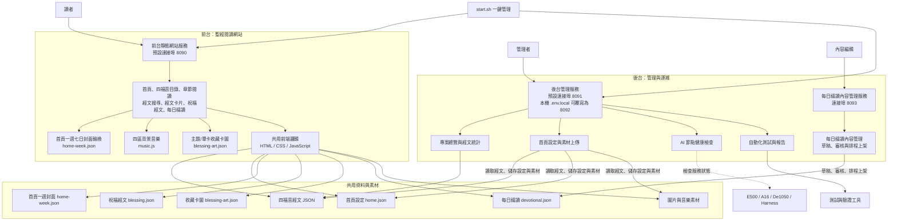

# Bible-Master

Bible-Master 是一個和合本四福音閱讀網站，包含讀者使用的前台，以及管理首頁內容、檢查服務與執行測試的後台。

## 主要架構



管理者透過後台修改首頁設定，設定與素材寫入共用目錄，前台再讀取這些檔案呈現給讀者。AI 節點由後台進行健康檢查。

## 前台功能

| 功能 | 說明 |
| --- | --- |
| 首頁 | 顯示指定經文、圖片與音樂 |
| 首頁一週封面 | 依星期切換七日主題封面（`home-week.json`） |
| 四福音目錄 | 選擇馬太、馬可、路加、約翰福音及章節 |
| 章節閱讀 | 閱讀各章節經文 |
| 經文搜尋 | 搜尋經文 |
| 經文卡片 | 顯示單節經文卡片 |
| 祝福經文 | 呈現祝福經文內容，收錄主題與單卡收藏卡圖（`blessing-art.json`） |
| 每日禱讀 | 依日期呈現每日禱讀文章（`devotional.html`、`devotional.json`） |
| 背景音樂 | 首頁、搜尋、卡片與祝福四區各自播放背景音樂（`music.js`、`zone-music.json`） |
| 福音藝廊 | 一週七日 16:9 油畫與專屬器樂靜聽（`gallery.html`、`gallery.js`、`gospel-gallery.json`） |

前台程式位於 [`bible-site/site/`](bible-site/site/)，經文與設定資料位於 [`bible-site/data/`](bible-site/data/)。

## 後台功能

| 功能 | 說明 |
| --- | --- |
| 專案總覽 | 顯示專案狀態及四福音統計 |
| 首頁管理 | 設定首頁經文、圖片、圖片說明及音樂，並上傳素材 |
| 每日禱讀管理 | 編輯、審核每日禱讀草稿並排程上架（獨立服務，連接埠 8093） |
| 模型狀態 | 檢查 E500、A16、De1050 與 Harness 服務連線 |
| 測試與報告 | 執行專案檢查、視覺檢查、經文比對及冒煙測試，並查看報告 |

後台由 [`bible-site/admin/server.py`](bible-site/admin/server.py) 提供管理頁面與 API。首頁設定及素材寫入會檢查權杖、來源及主機；後台預設僅監聽本機。

### 本機多埠分工

| 連接埠 | 服務 | 入口 | 說明 |
| --- | --- | --- | --- |
| `8090` | 前台靜態網站 | <http://127.0.0.1:8090/> | 聖經閱讀前台，由 `start.sh` 管理。 |
| `8091` | 預設後台 | <http://127.0.0.1:8091/> | 運維儀表板與管理 API；未設定 `.env.local` 時由 `start.sh` 管理（本機目前使用 8092）。 |
| `8092` | 本機覆寫後台 | <http://127.0.0.1:8092/> | 本機 `.env.local` 可將 `BACKEND_PORT` 覆寫為 `8092`，讓主後台改以此埠運行，與 8091 分開。 |
| `8093` | 每日禱讀內容管理 | <http://127.0.0.1:8093/#devotional-editor> | 獨立 systemd user unit `bible-site-admin-editor.service`，使用獨立私人權杖，專供每日禱讀內容管理。 |

- 主後台由 [`start.sh`](start.sh) 依 `.env.local` 選擇埠：預設 8091，本機覆寫為 8092；呼叫端明確指定的環境變數優先，測試用埠不會被覆寫。
- 8093 由 `bible-site-admin-editor.service` 啟動（`server.py --host 127.0.0.1 --port 8093`），已啟用自動啟動，權杖獨立存放於 `~/.local/state/bible-master/admin-editor/token`，不覆寫舊後台權杖。操作說明見 [`bible-site/admin/DEVOTIONAL-EDITOR.md`](bible-site/admin/DEVOTIONAL-EDITOR.md)。

### 每日禱讀自動發布機制

每日禱讀由獨立的 `bible-devotional-publish.timer` 於每日 06:00（Asia/Taipei）觸發。它會在獨立 checkout（`~/.local/share/bible-devotional/main`）先對齊 `origin/main`，再執行該目錄的 `publish_daily.py`，將已核准且不晚於當日的文章匯出並推送到正式網站。

因此，**開發工作樹內的 `bible-site/data/devotional.json` 篇數不會隨每日排程自動增加**，這是刻意隔離的設計：開發工作樹的資料檔與正式發布的獨立 checkout 互不干擾，正式站篇數請以正式 checkout 與實際公開網站為準，不要用工作樹的篇數判斷發布進度。

## 啟動與管理

需要 Python 3。在專案根目錄執行：

```bash
./start.sh start    # 啟動前台與後台
./start.sh status   # 查看服務狀態
./start.sh stop     # 停止服務
./start.sh logs     # 查看日誌
./start.sh test     # 執行檢查
```

- 前台預設入口：<http://127.0.0.1:8090/>
- 後台預設入口：<http://127.0.0.1:8091/>

連接埠與監聽位址可透過環境變數調整，詳見 [`start.sh`](start.sh)。

## 聖經在 AI 時代的福音工作影響力

### 使命與核心價值

Bible-Master 以聖經經文為中心，盼望在人工智慧（AI）與數位媒體快速發展的時代，讓更多人能方便地接觸、閱讀、理解與分享福音。科技是服事人的工具，而不是福音本身；傳福音的核心仍是耶穌基督、聖經真理，以及人與人之間真實的關懷與見證。

這項願景呼應《馬太福音》28:19–20 的大使命、《羅馬書》10:14–17 對聽見福音與信心的提醒，以及《提摩太後書》3:16–17 關於聖經教導與裝備的原則。

### AI 可帶來的福音工作機會（發展方向，非已上線功能）

| 面向 | 潛在影響力 | 應遵守的原則 |
| --- | --- | --- |
| 福音可及性 | 透過行動裝置、無障礙閱讀及多語言輔助，降低接觸聖經的門檻 | 尊重文化與語境，保留原文、譯本及出處 |
| 個人查經與學習 | 協助查找經文、整理主題、連結上下文，支援初信者及查經小組 | 清楚區分「經文原文」與「AI 生成解釋」 |
| 教會與同工服事 | 協助準備教材、福音素材及學習指引，減少重複性工作 | 講章、教義與牧養內容須由合適同工審閱 |
| 年輕世代與數位宣教 | 以易閱讀、易分享的形式，建立認識福音的入口 | 避免以流量或互動數字取代信仰成長與真實關係 |
| 跨地域連結 | 讓不同地區的使用者更容易取得聖經閱讀資源 | 重視個資、使用者同意與資訊安全 |

### AI 使用的界線與責任

- **聖經優先：** 經文引用應標示書卷、章節及譯本；AI 產生的摘要、翻譯、詮釋或建議不得冒充聖經原文。
- **人類查核：** AI 可能產生錯引、虛構經節或偏離上下文的解釋；重要神學內容應由人員核對，並鼓勵讀者回到完整經文查考（參考《使徒行傳》17:11）。
- **關係與牧養：** AI 不應取代教會、牧者、家人或信仰群體的陪伴；涉及危機、心理健康及重大生活決策時，應尋求適當的人際與專業協助。
- **尊重與透明：** 不以 AI 冒充牧者、屬靈權威或真人見證；清楚說明 AI 的使用範圍，保護提問紀錄與個人資料。
- **審慎衡量影響：** 優先觀察經文閱讀體驗、內容正確性、可及性與讀者回饋，而非只追求使用次數。

### Bible-Master 的定位

目前專案已提供四福音閱讀、經文搜尋、經文卡片、祝福經文、首頁一週封面、四區背景音樂、每日禱讀與首頁／禱讀內容管理等基礎能力，並具備 AI 節點狀態檢查；**這不代表網站已提供 AI 查經、AI 牧養或自動生成神學內容等功能。** 上述表格描述的是未來可能探索的應用方向，須經需求評估、神學內容審查、隱私與安全評估，以及功能測試後才能導入。

**我們期盼 AI 幫助更多人接觸聖經，而聖經持續成為人理解真理、生命、盼望與愛的根基。**
