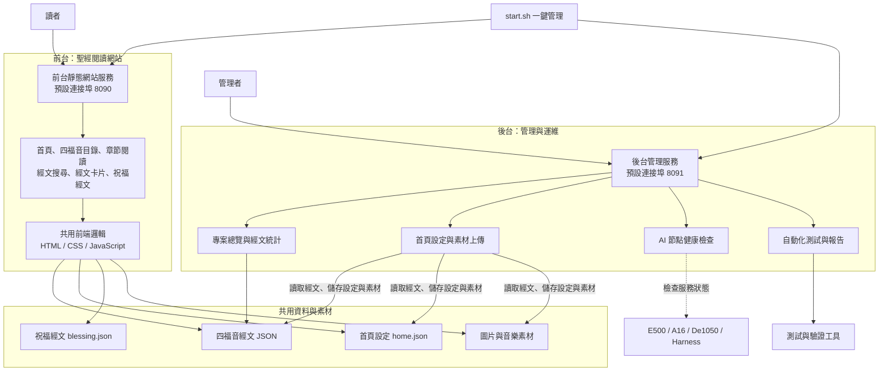

# Bible-Master

Bible-Master 是一個和合本四福音閱讀網站，包含讀者使用的前台，以及管理首頁內容、檢查服務與執行測試的後台。

## 主要架構



管理者透過後台修改首頁設定，設定與素材寫入共用目錄，前台再讀取這些檔案呈現給讀者。AI 節點由後台進行健康檢查。

## 前台功能

| 功能 | 說明 |
| --- | --- |
| 首頁 | 顯示指定經文、圖片與音樂 |
| 四福音目錄 | 選擇馬太、馬可、路加、約翰福音及章節 |
| 章節閱讀 | 閱讀各章節經文 |
| 經文搜尋 | 搜尋經文 |
| 經文卡片 | 顯示單節經文卡片 |
| 祝福經文 | 呈現祝福經文內容 |

前台程式位於 [`bible-site/site/`](bible-site/site/)，經文與設定資料位於 [`bible-site/data/`](bible-site/data/)。

## 後台功能

| 功能 | 說明 |
| --- | --- |
| 專案總覽 | 顯示專案狀態及四福音統計 |
| 首頁管理 | 設定首頁經文、圖片、圖片說明及音樂，並上傳素材 |
| 模型狀態 | 檢查 E500、A16、De1050 與 Harness 服務連線 |
| 測試與報告 | 執行專案檢查、視覺檢查、經文比對及冒煙測試，並查看報告 |

後台由 [`bible-site/admin/server.py`](bible-site/admin/server.py) 提供管理頁面與 API。首頁設定及素材寫入會檢查權杖、來源及主機；後台預設僅監聽本機。

## 啟動與管理

需要 Python 3。在專案根目錄執行：

```bash
./start.sh start    # 啟動前台與後台
./start.sh status   # 查看服務狀態
./start.sh stop     # 停止服務
./start.sh logs     # 查看日誌
./start.sh test     # 執行檢查
```

- 前台預設入口：<http://127.0.0.1:8090/>
- 後台預設入口：<http://127.0.0.1:8091/>

連接埠與監聽位址可透過環境變數調整，詳見 [`start.sh`](start.sh)。
